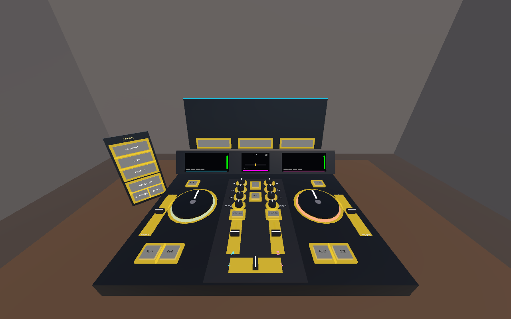
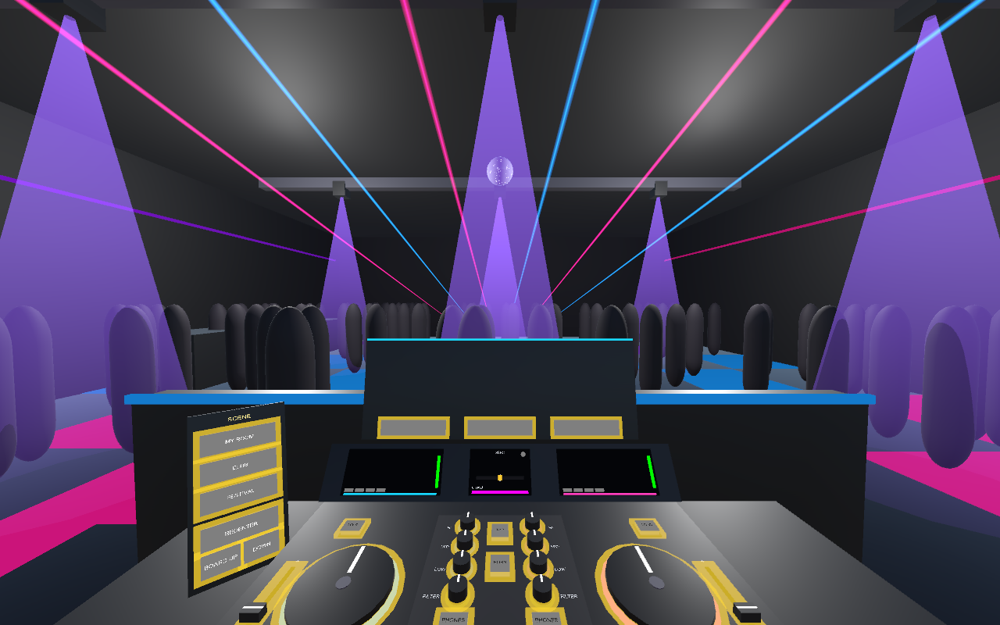
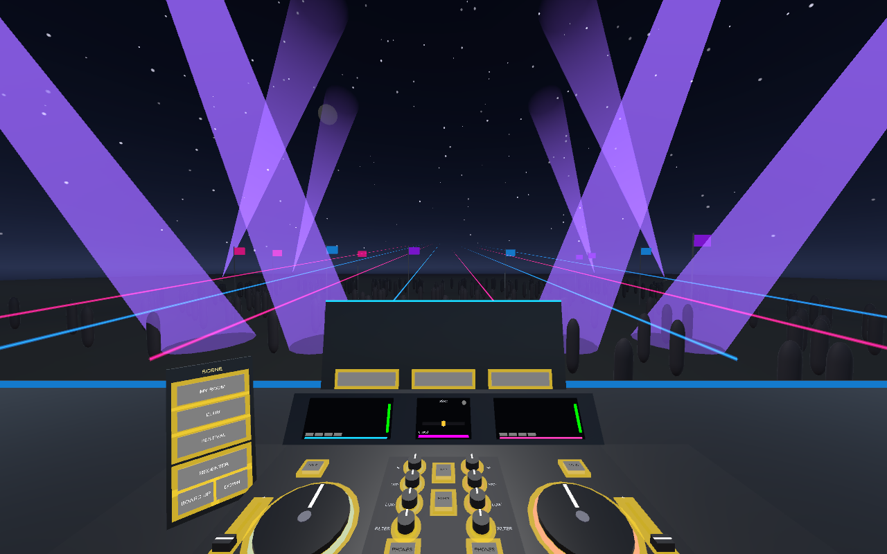
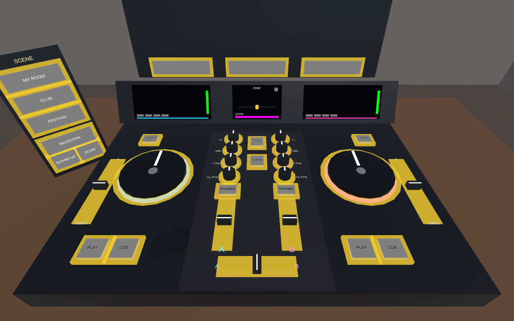
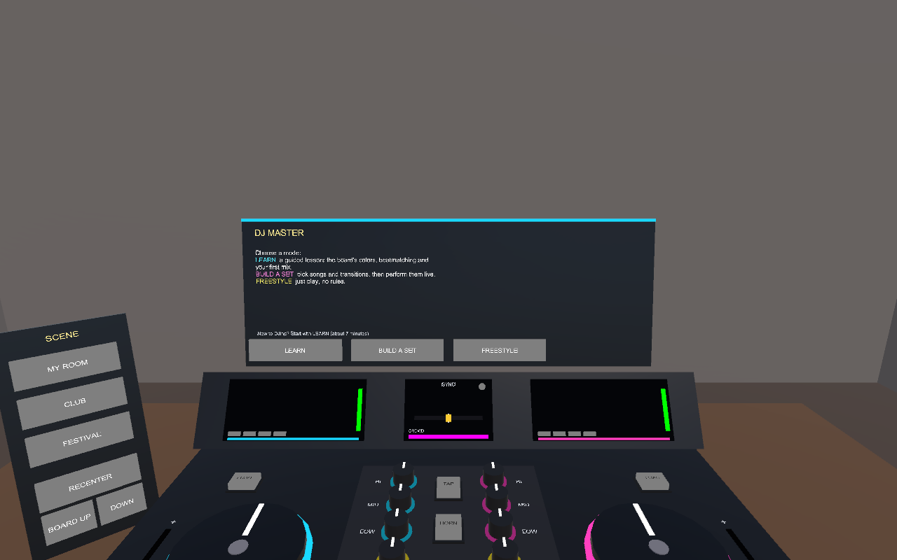
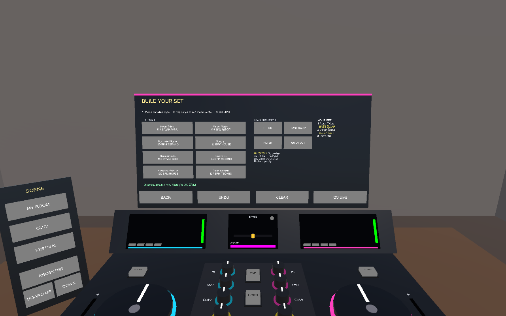

# DJ MASTER

Learn to DJ with just your hands. A mixed reality DJ school for Meta Quest.

A full DJ controller appears on your real desk: two decks, a mixer, jog wheels, EQs, filters and a crossfader.
Pick a mode, then pick where to play:

| Mode | What you do |
|---|---|
| **Learn** | A guided lesson (about 7 minutes): the board's color code, then from pressing PLAY to your first beatmatched transition. |
| **Build a set** | Choose 2-5 songs and the transition style into each one, then perform the set live with a step-by-step checklist. Every transition is graded. |
| **Freestyle** | Just play. No timer, no rules. |

| Venue | |
|---|---|
| **My room** | Mixed reality: your real surroundings through passthrough. |
| **Club** | Lasers, a mirror ball, an LED wall and a packed dance floor. |
| **Festival** | A night-time main stage with fireworks and a huge crowd. |

The crowd reacts to your mixing in every venue, and the SCENE panel switches venues at any time.

No controllers needed. Every interaction is a fingertip poke, slide or spin.

| Your room (mixed reality) | Club | Festival |
|---|---|---|
|  |  |  |



| Mode menu | Build a set |
|---|---|
|  |  |

*Editor renders. On Quest, the "room" view is your real room through passthrough.*

## Color code

Every control has a color, and Learn mode opens with a quick quiz on it:

| Color | Means |
|---|---|
| Blue | Deck A (left) |
| Pink | Deck B (right) |
| Green | PLAY |
| Orange | CUE (back to the first beat) |
| Yellow | FILTER and PHONES: shaping the sound, and what only you hear |
| Red | TAP and AIR HORN: for the crowd |

## What you learn

Learn mode is one guided session of 20 steps. The control you need next pulses gold, and a hint appears if you're stuck.

| # | Skill | What you do |
|---|---|---|
| 1-4 | Color code | Touch something blue, pink, yellow and orange |
| 5-7 | Decks and faders | Press PLAY, raise the channel fader, crossfade to Deck A |
| 8 | Feel the beat | Tap the TAP pad on four kicks in a row |
| 9 | Phrasing | Tap exactly on a 4-bar line (bar 1, 5, 9, 13) |
| 10-12 | Cueing | LOAD Deck B, preview it in the headphones (PHONES), press PLAY |
| 13 | Beatmatch: tempo | Ride Deck B's TEMPO fader until both BPMs match |
| 14 | Beatmatch: phase | Nudge Deck B's jog wheel until the SYNC light turns green |
| 15-18 | The blend | Cut the bass, bring Deck B in, swap the basslines, finish the transition |
| 19-20 | Effects | Filter sweep and the air horn |

## Build a set

Tap a transition style, then tap songs in the crate to add them in order. Each song is mixed in with the style that was
selected when you added it:

| Style | How it's done |
|---|---|
| Blend | Beatmatch, then crossfade slowly. |
| Bass swap | Cut the new song's LOW, blend, then trade basslines on a 4-bar line. |
| Filter fade | Blend while sweeping the old song's FILTER to muffle it. |
| Quick cut | Match the tempo, then on bar 1 hit PLAY and slam the crossfader. No overlap. |

**GO LIVE** performs the set. The next song is loaded for you, and a checklist walks you through each planned
transition with the right controls glowing. Each transition is graded PERFECT / GOOD / ROUGH with a tip. Crowd energy
rises for in-sync blends and bass drops (cut the LOW, slam it back on a bar line). It falls for trainwrecks, muddy
bass clashes and silence. Your set is saved between sessions.

## Hand controls

| Control | Gesture |
|---|---|
| Buttons | Poke down from above. Brushing past from the side won't trigger them. |
| Faders | Touch the cap and slide. The tempo fader is geared 1:3 for fine control and clicks into 0%. |
| Knobs | Touch the top and slide your finger away/right to turn up, toward you/left to turn down. Double-tap to reset to center. |
| Jog wheels | Rest a fingertip on the platter and spin: clockwise speeds the track up, counter-clockwise slows it. When paused, it scrubs. |

A glowing dot on each index fingertip shows exactly where you're touching, and turns gold while you're holding a control.
The platters turn once per bar with their white marker pointing forward on beat 1, so two in-phase tracks have matching markers.

**Scene panel** (to the left of the board): MY ROOM / CLUB / FESTIVAL, RECENTER, and BOARD UP / DOWN for comfort.

## Designed for the hackathon guidelines

- **Hands-first:** everything works with hands alone. Nothing needs a controller.
- **Seated, airplane-seat friendly:** the board snaps in front of you at desk height, with every control inside arm's reach. RECENTER and height buttons are always available.
- **Bus-stop test:** cold start lands you on the menu with tracks preloading. One lesson is about 7 minutes and a 3-song set about 3. Taking the headset off or opening the system menu pauses audio and time, and the game resumes where you left off.
- **Original, not a wrapper:** all eight tracks are synthesized at runtime by `TrackSynth` (house, techno and disco loops, arranged in DJ phrases). There is no licensed music, no streaming, and no third-party services.

## Run it in the editor (no headset)

1. Open the project in **Unity 6000.6.4f1** and open `Assets/Scenes/DJMaster.unity`.
2. Press Play. The view starts tilted down at the board, and the mouse acts as a fingertip:
   - **Left click / drag:** press buttons, drag faders, turn knobs (drag up/right), spin the jog wheels
   - **Scroll wheel:** turn the knob under the cursor
   - **Right drag:** look around

To regenerate the scene after changing the builder: **DJ Master > Build Scene**.

## Build to Quest

1. **Unity Hub > Installs > 6000.6.4f1 > Add modules > Android Build Support** (include OpenJDK and Android SDK & NDK).
2. **DJ Master > Configure Player Settings for Quest** (IL2CPP, ARM64, min API 32, package `com.djmaster.vr`, hand tracking + passthrough).
3. **File > Build Profiles > Android > Switch Platform**.
4. **Edit > Project Settings > XR Plug-in Management > Android tab:** check **OpenXR**, then under OpenXR enable the **Meta XR** feature group. Then open **Edit > Project Settings > Meta XR**, pick the Android tab and click **Fix All**.
5. Put the Quest in developer mode, connect over USB, then **Build And Run**.

**For the competition:** upload the APK to a release channel named **Competition** in the Meta Developer Dashboard and create an Invite URL for the judges.

## Tests

- **EditMode (20):** mixer math (constant-power crossfader, EQ curve, tempo range, phase wrap), synth loop length/levels/kick timing, text wrap with color tags, set lists (add, undo, save/load), set stars.
- **PlayMode (7):** loads the real scene and drives it with a simulated fingertip. Covers poking PLAY (and *not* triggering it from the side), fader drags, the fine-geared tempo fader, venue switching, menu > venue > color quiz, a full Learn run from step 1 to "LESSON COMPLETE", and building and performing a 3-song set with a perfect blend and a perfect quick cut.

Run them from **Window > General > Test Runner**.

## Project map

```
Assets/DJMaster/
  Scripts/Audio/        TrackSynth (procedural music), TrackLibrary, Deck, ChannelStrip (EQ/filter DSP), Mixer, Sfx, DJMath
  Scripts/Interaction/  Pointer, HandPointerSource (index fingertip), MousePointerSource, PokeButton, Fader, Knob, JogWheel
  Scripts/Game/         GameDirector (menus and modes), LessonDirector (Learn), SetList + SetPerformer (Build a set / live show),
                        MixJudge (crowd energy + score), DJBoard
  Scripts/UI/           BoardColors (the color code), DeckDisplay, SyncMeter, InstructionPanel, SetBuilderPanel
  Scripts/World/        EnvironmentManager (passthrough/club/festival), SeatedAnchor, Crowd (GPU-instanced), LightShow, MeshKit
  Shaders/              Additive + Glow (single-pass stereo safe)
  Editor/SceneBuilder.cs  builds the entire scene from primitives
```

Built with the Meta XR Core SDK v207 (OVRCameraRig, OVRHand/OVRSkeleton with OpenXR hand skeletons, OVRPassthroughLayer).
